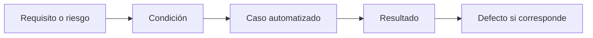

[Ver el resumen en video](/media/playwright/base-prueba-caso-trazable.mp4)

La automatización debe poder explicar de dónde salió cada caso y qué evidencia produjo. El punto de partida es la **base de prueba**: requisitos, historias de usuario, criterios de aceptación, reglas de negocio, diseños, riesgos o comportamiento acordado contra los que se analiza el producto.

Si la base es ambigua, el script no resuelve la ambigüedad; solo la codifica.

## Cadena de análisis y diseño

Una forma útil de razonar es avanzar por estas capas:

1. **Base de prueba:** qué documento, regla o conversación define la expectativa.
2. **Condición de prueba:** qué aspecto verificable merece atención.
3. **Escenario:** situación concreta con contexto, acción y resultado.
4. **Caso de prueba:** precondiciones, datos, pasos y resultados esperados suficientemente precisos.
5. **Procedimiento o script:** implementación ejecutable del caso.
6. **Resultado:** evidencia obtenida durante la ejecución.
7. **Defecto:** registro trazable si el resultado real contradice la expectativa válida.

Ejemplo de base: “una cuenta se bloquea después de cinco intentos fallidos consecutivos”. Algunas condiciones son el conteo de intentos, el bloqueo y la recuperación. Un escenario de borde prueba cuatro, cinco y seis intentos. El script Playwright es la última traducción, no el origen del caso.

## Criterios de aceptación y resultados esperados

Un criterio de aceptación debería ser comprobable. El formato Given/When/Then puede aclarar contexto, acción y consecuencia:

```text
Dado que la cuenta tiene cuatro intentos fallidos consecutivos
Cuando se envía una quinta contraseña inválida
Entonces la cuenta queda bloqueada y se informa el motivo
```

El resultado esperado funciona como **oráculo de prueba**: la fuente que permite decidir si el resultado real es correcto. Puede provenir de una regla de negocio, cálculo independiente, contrato de API o comportamiento aprobado. “La página se ve bien” rara vez es un oráculo suficiente.

## Trazabilidad

La trazabilidad conecta elementos para responder preguntas de cobertura e impacto:



Con esa cadena se puede preguntar:

- ¿qué requisitos no tienen casos?;
- ¿qué tests deben revisarse si cambia una regla?;
- ¿qué riesgo estaba cubriendo un test fallido?;
- ¿qué evidencia respalda el cierre de un defecto?

La trazabilidad no exige una herramienta cara. Códigos estables en títulos, archivos o anotaciones pueden ser suficientes para un equipo pequeño si se mantienen con disciplina.

## Pipeline de calidad

Un pipeline conecta cambios con verificaciones automáticas. La trazabilidad aporta significado a sus resultados: no alcanza con saber que falló `checkout.spec.ts`; el equipo necesita entender qué comportamiento, requisito y riesgo están comprometidos.

Un pipeline introductorio suele ejecutar:

1. instalación reproducible de dependencias;
2. preparación del navegador y entorno;
3. tests rápidos que bloquean errores básicos;
4. suites más amplias según costo y riesgo;
5. publicación de resultados y artefactos para diagnóstico.

## Why It Matters

La trazabilidad evita que el código de prueba se convierta en una colección de rituales sin propósito visible. Cuando cambia el producto, permite distinguir qué tests deben adaptarse, cuáles revelan una regresión y cuáles ya no representan una necesidad vigente.

Antes de automatizar, deberías poder señalar la base, expresar el resultado esperado y explicar el riesgo. Si falta alguno, el siguiente paso no es abrir el editor: es aclarar la prueba.
