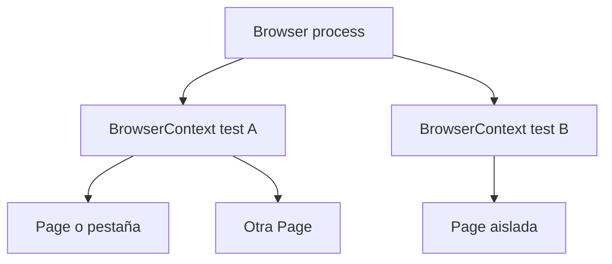

[Ver el resumen en video](/media/playwright/playwright-arquitectura-ecosistema.mp4)

Playwright es una biblioteca de automatización de navegadores. En Node.js, Playwright Test agrega un runner diseñado para pruebas end-to-end con assertions, aislamiento, paralelismo, configuración, reportes y trazas integrados.

Conviene distinguir ambas capas:

- **Playwright Library** ofrece las APIs para lanzar navegadores, crear contextos, abrir páginas e interactuar.
- **Playwright Test** organiza casos, fixtures, expectativas, workers, proyectos, retries, artefactos y reportes.

Para este curso usaremos TypeScript y Playwright Test, porque el programa parte de Node.js/npm y necesita el runner completo.

## Navegador, contexto y página

El modelo mental central tiene tres niveles:



- `Browser` representa un proceso de navegador controlado.
- `BrowserContext` equivale a un perfil limpio y aislado: cookies, almacenamiento y sesiones propios.
- `Page` representa una pestaña o página dentro de un contexto.

Playwright Test entrega normalmente una fixture `page` nueva para cada test. Esa página vive en un contexto aislado, aunque el runner reutilice procesos de navegador para ser eficiente. El aislamiento reduce fallos en cascada y dependencia del orden de ejecución.

```ts
import { test, expect } from '@playwright/test';

test('muestra el título', async ({ page }) => {
  await page.goto('https://example.com');
  await expect(page).toHaveTitle(/Example/);
});
```

No fue necesario crear ni cerrar `browser`, `context` o `page`: el runner administra las fixtures integradas.

## Motores de navegador

Playwright controla tres familias principales:

- Chromium, base de Chrome y Edge;
- Firefox;
- WebKit, motor usado por Safari.

Cada versión de Playwright espera binarios compatibles. Por eso instalar o actualizar el paquete y descargar navegadores son pasos relacionados. Los proyectos de configuración permiten ejecutar la misma suite en distintas combinaciones.

## Lenguajes soportados

La implementación central se expone en varios lenguajes, pero el ecosistema de testing cambia:

| Lenguaje | Integración recomendada |
| --- | --- |
| JavaScript/TypeScript | Playwright Test integrado. |
| Python | Plugin para pytest. |
| Java | Integración con JUnit o TestNG. |
| .NET | Bases para MSTest, NUnit y xUnit. |

El PDF del curso menciona JavaScript, TypeScript, Python y .NET. Java también está soportado oficialmente, pero queda fuera del alcance aprobado. Los conceptos de navegador, contexto, página y localizador se transfieren; la sintaxis y el runner no son idénticos.

## Comunicación y asincronía

Las acciones del navegador son asíncronas. En TypeScript, la mayoría devuelve `Promise`, por lo que se usa `await`:

```ts
await page.goto('/login');
await page.getByLabel('Correo').fill('ana@example.test');
await page.getByRole('button', { name: 'Ingresar' }).click();
```

Omitir `await` puede dejar operaciones pendientes y producir resultados engañosos. Playwright agrega auto-waiting, pero no puede corregir una promesa que el test decidió no esperar.

## Why It Matters

El modelo `browser → context → page` explica gran parte de Playwright: aislamiento, sesiones, ventanas, paralelismo y limpieza. Cuando un test comparte estado accidentalmente, la pregunta útil es qué contexto posee ese estado y quién controla su ciclo de vida.

El runner no es un detalle secundario. Define cómo se descubren, aíslan, ejecutan y reportan los tests. Comprender esta frontera evita mezclar ejemplos de la biblioteca pura con APIs disponibles únicamente dentro de Playwright Test.
