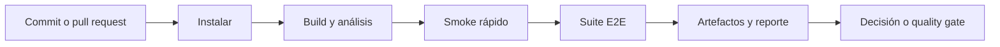

[Ver el resumen en video](/media/playwright/ci-cd-estrategia-agil.mp4)

Integración continua (CI) significa integrar cambios con frecuencia y verificarlos automáticamente. Entrega y despliegue continuos extienden ese flujo hacia artefactos liberables o producción. Playwright aporta una señal, pero el pipeline combina varias verificaciones y decisiones.

## Pipeline de calidad



Un quality gate es una condición que debe cumplirse para avanzar, por ejemplo que las rutas críticas pasen. Debe corresponder a un riesgo real y tener una señal confiable. Bloquear por tests flaky convierte el gate en fricción; ignorarlos elimina protección.

## Estrategia por velocidad y riesgo

No todas las pruebas deben ejecutarse en el mismo momento:

- en cada commit: comprobaciones rápidas y de alto valor;
- en pull requests: smoke y regresión relevante;
- en main o por horario: suites más amplias, navegadores adicionales;
- antes de liberar: riesgos críticos y evidencia necesaria.

La frecuencia depende del costo y del tiempo de feedback. Un test que tarda veinte minutos puede ser válido, pero quizá no pertenezca al primer gate de cada cambio.

## Tres pasos mínimos para Playwright en CI

1. Instalar dependencias npm de forma reproducible.
2. Instalar navegadores y dependencias del sistema, o usar una imagen compatible.
3. Ejecutar `npx playwright test` y conservar evidencia relevante.

```bash
npm ci
npx playwright install --with-deps
npx playwright test
```

## Recursos y workers

La documentación recomienda empezar con un worker en CI para favorecer estabilidad y reproducibilidad:

```ts
export default defineConfig({
  workers: process.env.CI ? 1 : undefined,
});
```

Esto no es una regla eterna. Después de medir recursos y aislamiento, el equipo puede habilitar más workers o sharding. Aumentar concurrencia por encima de la capacidad del agente puede crear timeouts que no existen en el producto.

## Equipos ágiles

El testing no es una fase final separada. En una iteración saludable:

- criterios de aceptación se discuten antes de implementar;
- riesgos orientan la selección de casos;
- desarrolladores y testers comparten responsabilidad por la señal;
- los defectos y flaky tests se tratan como trabajo visible;
- la retrospectiva ajusta tiempos, cobertura y mantenimiento.

La automatización acorta feedback, pero solo si el equipo responde a sus resultados. Un dashboard rojo ignorado no aporta control de calidad.

## Why It Matters

CI convierte una suite local en una capacidad del equipo. La pregunta deja de ser “¿funciona en mi máquina?” y pasa a ser “¿podemos reproducir la evidencia para cada cambio?”.

Diseñá el pipeline como una secuencia de decisiones: qué riesgo detecta cada etapa, cuánto tarda y qué debe hacer el equipo cuando falla.
